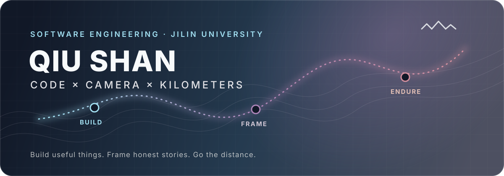
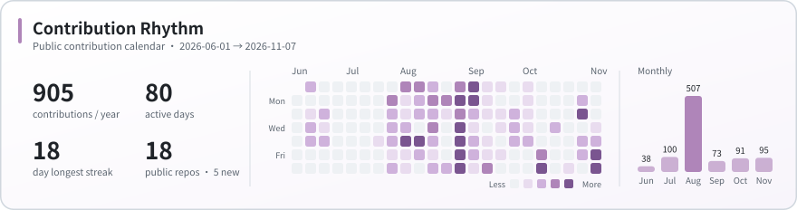
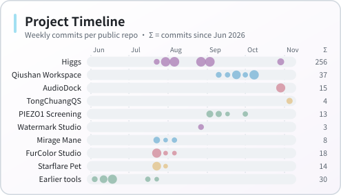
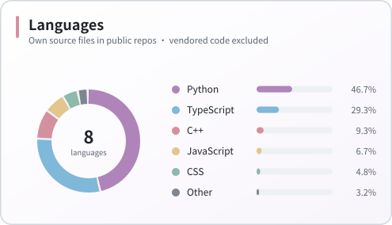
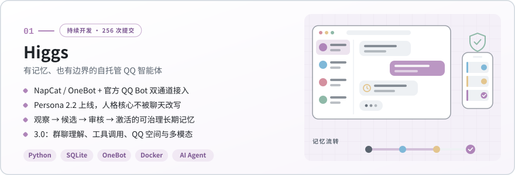
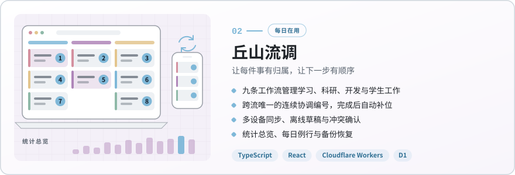
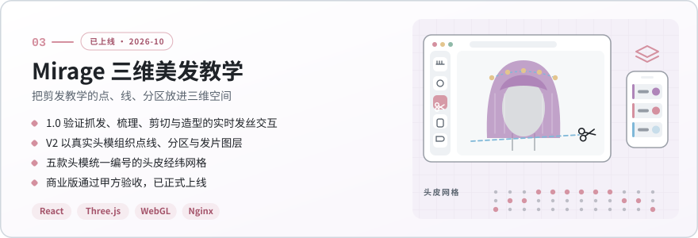

**中文** · [English](README_EN.md)

  

  
  
  
  

  
  
  

## 你好，我是丘山

吉林大学软件工程专业大二在读，目标方向是 **AI 应用与机器学习工程**。我习惯用 AI 协作开发，把真实需求做成能上线、能验证、能持续迭代的产品；正在进行 Vibe Coding、程序设计竞赛、数学建模、计算机视觉、嵌入式等领域的学习和研究。

目前我在吉林大学人工智能学院 Solar 课题组参与 **SENSRING 声音识别指环** 的硬件与开发、尝试脉冲大模型的本地部署。代码之外，我热爱摄影创作和中长跑，并在持续学习使用 DaVinci Resolve、Lightroom、Premiere Pro、Photoshop 等工具进行影像后期处理。

| <code>CODE / 工程</code> | <code>CAMERA / 影像</code> | <code>KILOMETERS / 长跑</code> |
|:---|:---|:---|
| AI 智能体、3D 交互、全栈产品、端侧部署 | 活动与人像摄影、Vlog、后期与水印工作流 | 路跑、越野跑、训练计划与赛后复盘 |

## 贡献概览 · Development Activity

  <picture>
    <source media="(prefers-color-scheme: dark)" srcset="./assets/activity-overview-dark.svg">
    
  </picture>

  <picture>
    <source media="(prefers-color-scheme: dark)" srcset="./assets/project-timeline-dark.svg">
    
  </picture>
  <picture>
    <source media="(prefers-color-scheme: dark)" srcset="./assets/top-languages-dark.svg">
    
  </picture>

自 8 月中旬上次更新以来：新建 5 个公开仓库，Higgs 新增 210+ 次提交并完成双通道与 Persona 2.2 上线。数据更新于 2026-11-07，来自公开贡献日历与公开非 Fork 仓库的提交记录；贡献数可能包含匿名显示的私有贡献，语言占比按自有源码体积计算、已排除第三方与打包文件。

## 代表项目 · Featured Work

  <a href="https://github.com/PWJCSqiushan/Higgs"><picture>
    <source media="(prefers-color-scheme: dark)" srcset="./assets/cards/higgs-zh-dark.svg">
    
  </picture></a>

<a href="https://github.com/PWJCSqiushan/Higgs">Higgs</a> · <a href="https://github.com/PWJCSqiushan/Higgs#readme">架构与安全模型</a>

  <a href="https://github.com/PWJCSqiushan/qiushan-workspace"><picture>
    <source media="(prefers-color-scheme: dark)" srcset="./assets/cards/workspace-zh-dark.svg">
    
  </picture></a>

<a href="https://github.com/PWJCSqiushan/qiushan-workspace">丘山流调</a> · <a href="https://github.com/PWJCSqiushan/qiushan-workspace#readme">工作流与部署指南</a>

  <a href="https://github.com/PWJCSqiushan/Mirage-Mane-V2"><picture>
    <source media="(prefers-color-scheme: dark)" srcset="./assets/cards/mirage-zh-dark.svg">
    
  </picture></a>

<a href="https://github.com/PWJCSqiushan/Mirage-Mane">Mirage Mane 1.0</a> · <a href="https://github.com/PWJCSqiushan/Mirage-Mane-V2">V2 教学工作台</a> · <a href="https://github.com/PWJCSqiushan/mirage-scalp-grid-viewer">头皮坐标网格</a> · 商业版为私有仓库

## 已上线的商业项目 · Shipped for Clients

| 项目 | 做了什么 | 技术与状态 |
|---|---|---|
| **Mirage 三维美发教学系统** | 以乙方身份独立承接，把剪发教学动作做成可操作的三维交互，含跨发片切割与头皮辅助网格 | <code>React</code> <code>Three.js</code> <code>Nginx</code> 2026-10 正式上线 |
| **轩岳体育教学与家庭训练小程序** | 面向 5–16 岁青少年体育教学，打通建档测评 → 课堂反馈 → 家庭训练 → 成长报告；按年龄段常模生成六维雷达图与训练处方 | <code>微信小程序</code> <code>云开发</code> 2026-08-24 上线，持续迭代 |

商业项目代码为私有仓库，不在此公开。

## 其他项目 · More Projects

| 项目 | 主要内容 | 技术与定位 |
|---|---|---|
| **[同窗 QS](https://github.com/PWJCSqiushan/TongChuangQS-Public)** <code>NEW</code> C++ 社交模拟系统 | 以公共服务核心组织 QQ、微信、微博、微商四种模拟服务，图形界面与控制台共用业务逻辑；本地持久化与 TCP 双窗口聊天 | <code>C++17</code> <code>Qt Widgets</code> <code>CMake</code> 面向对象课程设计 |
| **[AudioDock · 音频坞](https://github.com/PWJCSqiushan/audiodock)** <code>NEW</code> 视频链接转音频 | 粘贴分享文字即可解析、排队、转码、校验并下载 MP3 / FLAC 等格式；GitHub Pages 前端 + Render 后端已部署 | <code>Python</code> <code>FastAPI</code> <code>React</code> <code>FFmpeg</code> [在线体验](https://pwjcsqiushan.github.io/audiodock/) |
| **[Offline Watermark Studio](https://github.com/PWJCSqiushan/offline-watermark-studio)** <code>NEW</code> 离线图片水印 | 单张精调与批量 ZIP 导出，全部在浏览器本地完成，不上传任何照片；附可复用的 Codex Skill | <code>JavaScript</code> <code>Canvas</code> [在线使用](https://pwjcsqiushan.github.io/offline-watermark-studio/) |
| **[PIEZO1 Virtual Screening](https://github.com/PWJCSqiushan/piezo1-virtual-screening)** <code>NEW</code> 候选分子计算筛查 | 整合口袋预测共识、DrugCLIP 复排、RDKit 结构警报与 ADMET 证据，保留版本与复核边界，服务生命科学竞赛团队 | <code>Python</code> <code>RDKit</code> 科研计算流程 |
| **[FurColor Studio](https://github.com/PWJCSqiushan/FurColor-Studio)** AI 摄影后期工作站 | 面向兽聚摄影的本地优先批量后期：选片、主体分组、人脸隐私复核、参考样片调色与可校验交付 | <code>Python</code> <code>FastAPI</code> <code>OpenCV</code> <code>YOLO</code> v4.1 |
| **[JKS](https://github.com/PWJCSqiushan/JKS)** 智能语音交互助手 | 串联桌面端录音、STT、智能体、TTS 与 ESP32-S3 圆形 AMOLED 表情反馈 | <code>Python</code> <code>C++</code> <code>ESP32-S3</code> 软硬件交互原型 |

<strong>展开项目档案 / Project archive</strong>

| 项目 | 一句话说明 |
|---|---|
| [Starflare Codex Pet](https://github.com/PWJCSqiushan/starflare-codex-pet) | 符合 Codex v2 规范的 8×11 动画精灵图，含校验与透明边缘清理 |
| [StockHub](https://github.com/PWJCSqiushan/stockhub) | 影像作品上传、EXIF 展示、订单与下载的全栈原型 |
| [chaoxing-fanya](https://github.com/PWJCSqiushan/chaoxing-fanya) | 在开源项目基础上补充 Web 可视化、OCR、通知与便携打包 |
| [chaoxing-quiz-pdf](https://github.com/PWJCSqiushan/chaoxing-quiz-pdf) | 抓取、整理题目并生成可打印 PDF 的学习资料工具 |
| [hospital-management-system](https://github.com/PWJCSqiushan/hospital-management-system) | 使用 C/C++ 实现完整门诊业务流程的课程设计项目 |
| [cloudflare-edgetunnel-v2rayn-guide](https://github.com/PWJCSqiushan/cloudflare-edgetunnel-v2rayn-guide) | 根据实际部署与排障过程整理的网络配置指南 |

## 当前方向 · Current Focus

- **科研**：SENSRING 声音识别指环硬件组——芯片选型与硬件部署方案；参与脉冲神经网络（SNN）模型在 FPGA 上的部署调试与推理优化
- **智能体**：推进 Higgs 3.0 的群聊理解、受控工具调用与多模态，扩大官方通道的验收范围
- **产品交付**：持续迭代轩岳体育小程序与 Mirage 商业版，把用户反馈转成下一版功能
- **专业基础**：C++ 程序设计竞赛与算法训练、数学建模、计算机系统与 Linux
- **影像与训练**：活动与人像拍摄、日常 Vlog；用阶段复盘指导路跑与越野训练

## 技术栈与工具 · Tech Stack

以下内容综合了已经在项目中使用的技术，以及现阶段重点学习和补强的方向。

  <strong>Languages</strong>  
  

  <strong>AI · Web · Data</strong>  
  

  <strong>Engineering · Creative</strong>  
  

## 个人方向 · Beyond Development

- 📷 持续进行活动、人像与视频拍摄和后期调色，并把真实需求做成工具（如 FurColor Studio、离线水印）
- 🏃 中国田协大众一级运动员，完成北京、大连、长沙、长春、吉林、哈尔滨、天津等十余场路跑赛事，参与 2026 高百接力赛、CURA 中国大学生路跑联赛、2026 松花湖·东北100 跑山赛等
- 🧭 担任班长与学生会秘书部副部长；推进程序设计竞赛、数学建模等长期学习

## 联系与交流 · Connect

如果你对 **AI 智能体、3D 交互、创作者工具、智能硬件或开源协作** 感兴趣，欢迎：

- [公开留言或提出合作想法](https://github.com/PWJCSqiushan/PWJCSqiushan/issues/new?template=say-hello.yml)
- [浏览全部仓库](https://github.com/PWJCSqiushan?tab=repositories)
- [发送邮件](mailto:dongzongyue@gmail.com)
