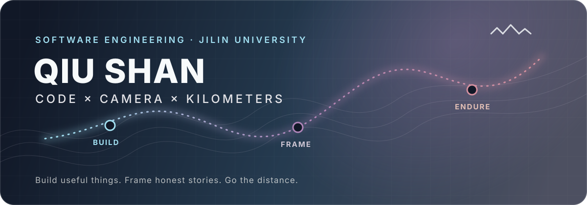
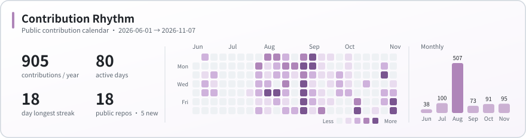
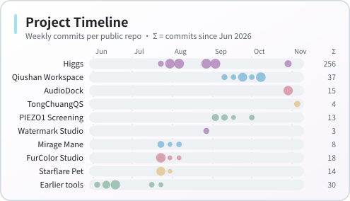
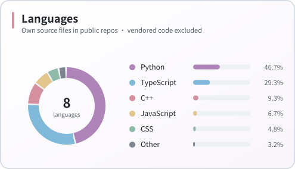
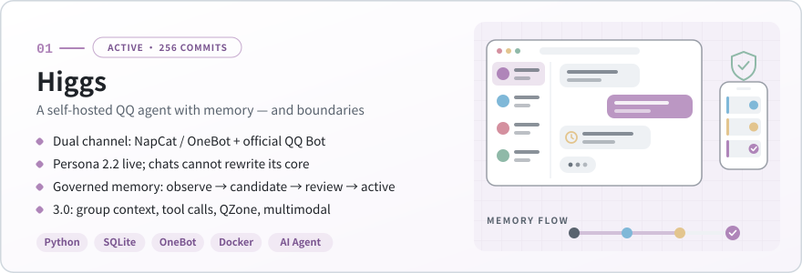
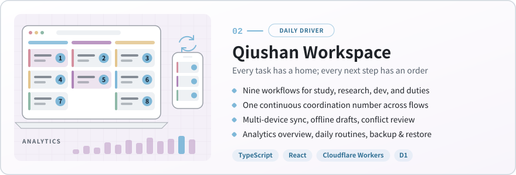
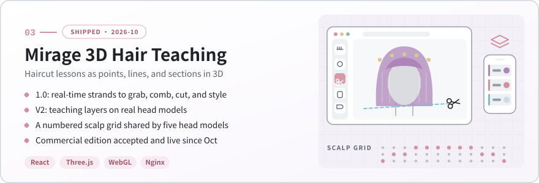

[中文](README.md) · **English**

  

  
  
  
  

  
  
  

## Hi, I'm Qiu Shan

I am a second-year Software Engineering student at Jilin University, heading toward **AI applications and machine-learning engineering**. I build with AI as a collaborator and aim to turn real needs into products that ship, can be verified, and keep improving. I am currently studying and researching vibe coding, competitive programming, mathematical modelling, computer vision, and embedded systems.

In the Solar group at the JLU School of Artificial Intelligence, I work on hardware and development for the **SENSRING sound-recognition ring** and experiment with running spiking large language models locally. Beyond code, I love photography and middle- and long-distance running, and I keep developing my post-production workflow with DaVinci Resolve, Lightroom, Premiere Pro, and Photoshop.

| <code>CODE</code> | <code>CAMERA</code> | <code>KILOMETERS</code> |
|:---|:---|:---|
| AI agents, 3D interaction, full-stack products, on-device deployment | Event and portrait photography, vlogs, post-production and watermark workflows | Road and trail running, training plans, race reviews |

## Development Activity

  <picture>
    <source media="(prefers-color-scheme: dark)" srcset="./assets/activity-overview-dark.svg">
    
  </picture>

  <picture>
    <source media="(prefers-color-scheme: dark)" srcset="./assets/project-timeline-dark.svg">
    
  </picture>
  <picture>
    <source media="(prefers-color-scheme: dark)" srcset="./assets/top-languages-dark.svg">
    
  </picture>

Since the previous refresh in mid-August: 5 new public repositories, and 210+ new commits to Higgs, including the dual-channel rollout and Persona 2.2. Updated 2026-11-07 from the public contribution calendar and commit history of public non-fork repositories. Contributions may include anonymised private activity; language share is measured by own source size, excluding vendored and bundled files.

## Featured Work

  <a href="https://github.com/PWJCSqiushan/Higgs"><picture>
    <source media="(prefers-color-scheme: dark)" srcset="./assets/cards/higgs-en-dark.svg">
    
  </picture></a>

<a href="https://github.com/PWJCSqiushan/Higgs">Higgs</a> · <a href="https://github.com/PWJCSqiushan/Higgs#readme">Architecture & safety model</a>

  <a href="https://github.com/PWJCSqiushan/qiushan-workspace"><picture>
    <source media="(prefers-color-scheme: dark)" srcset="./assets/cards/workspace-en-dark.svg">
    
  </picture></a>

<a href="https://github.com/PWJCSqiushan/qiushan-workspace">Qiushan Workspace</a> · <a href="https://github.com/PWJCSqiushan/qiushan-workspace#readme">Workflows & deployment</a>

  <a href="https://github.com/PWJCSqiushan/Mirage-Mane-V2"><picture>
    <source media="(prefers-color-scheme: dark)" srcset="./assets/cards/mirage-en-dark.svg">
    
  </picture></a>

<a href="https://github.com/PWJCSqiushan/Mirage-Mane">Mirage Mane 1.0</a> · <a href="https://github.com/PWJCSqiushan/Mirage-Mane-V2">V2 workspace</a> · <a href="https://github.com/PWJCSqiushan/mirage-scalp-grid-viewer">Scalp grid viewer</a> · commercial edition is private

## Shipped for Clients

| Project | What I built | Stack & status |
|---|---|---|
| **Mirage 3D Hairdressing Teaching System** | Delivered independently as the contractor: haircut teaching moves as operable 3D interactions, including cross-section cuts and a scalp guide grid | <code>React</code> <code>Three.js</code> <code>Nginx</code> Live since Oct 2026 |
| **Xuanyue Youth Sports & Home Training Mini Program** | Youth (ages 5–16) sports teaching flow: intake assessment → class feedback → home training → growth report, with age-normed six-axis radar charts and training plans | <code>WeChat Mini Program</code> <code>Cloud Base</code> Live since 2026-08-24 |

Client code lives in private repositories.

## More Projects

| Project | What it does | Stack & role |
|---|---|---|
| **[TongChuangQS](https://github.com/PWJCSqiushan/TongChuangQS-Public)** <code>NEW</code> C++ social simulation | One service core for simulated QQ, WeChat, Weibo, and WeShop services; GUI and console share the business logic, with local persistence and two-window TCP chat | <code>C++17</code> <code>Qt Widgets</code> <code>CMake</code> OOP course project |
| **[AudioDock](https://github.com/PWJCSqiushan/audiodock)** <code>NEW</code> Video link to audio | Paste share text to parse, queue, transcode, verify, and download MP3 / FLAC and more; deployed on GitHub Pages + Render | <code>Python</code> <code>FastAPI</code> <code>React</code> <code>FFmpeg</code> [Try it](https://pwjcsqiushan.github.io/audiodock/) |
| **[Offline Watermark Studio](https://github.com/PWJCSqiushan/offline-watermark-studio)** <code>NEW</code> Offline image watermarks | Single-image tuning and batch ZIP export, entirely in the browser with no uploads; ships with a reusable Codex Skill | <code>JavaScript</code> <code>Canvas</code> [Use online](https://pwjcsqiushan.github.io/offline-watermark-studio/) |
| **[PIEZO1 Virtual Screening](https://github.com/PWJCSqiushan/piezo1-virtual-screening)** <code>NEW</code> Computational screening | Pocket-prediction consensus, DrugCLIP re-ranking, RDKit structural alerts, and ADMET evidence, with versioned rules and review boundaries for a life-science competition team | <code>Python</code> <code>RDKit</code> Research pipeline |
| **[FurColor Studio](https://github.com/PWJCSqiushan/FurColor-Studio)** AI photo post-production | Local-first batch workflow for fursuit event photography: culling, subject grouping, face-privacy review, reference-guided grading, verifiable delivery | <code>Python</code> <code>FastAPI</code> <code>OpenCV</code> <code>YOLO</code> v4.1 |
| **[JKS](https://github.com/PWJCSqiushan/JKS)** Voice assistant | Desktop recording, STT, agent, TTS, and expression feedback on an ESP32-S3 round AMOLED | <code>Python</code> <code>C++</code> <code>ESP32-S3</code> Hardware–software prototype |

<strong>Project archive</strong>

| Project | Summary |
|---|---|
| [Starflare Codex Pet](https://github.com/PWJCSqiushan/starflare-codex-pet) | 8×11 animated sprite sheet following the Codex v2 spec, with validation and edge clean-up |
| [StockHub](https://github.com/PWJCSqiushan/stockhub) | Full-stack prototype for photo uploads, EXIF display, orders, and downloads |
| [chaoxing-fanya](https://github.com/PWJCSqiushan/chaoxing-fanya) | Extends an open-source project with a web UI, OCR, notifications, and portable packaging |
| [chaoxing-quiz-pdf](https://github.com/PWJCSqiushan/chaoxing-quiz-pdf) | Collects and organises questions into printable PDFs |
| [hospital-management-system](https://github.com/PWJCSqiushan/hospital-management-system) | C/C++ course project covering a complete outpatient workflow |
| [cloudflare-edgetunnel-v2rayn-guide](https://github.com/PWJCSqiushan/cloudflare-edgetunnel-v2rayn-guide) | Network configuration notes from real deployment and troubleshooting |

## Current Focus

- **Research**: SENSRING hardware group — chip selection and hardware deployment plans; deployment debugging and inference optimisation of spiking neural network (SNN) models on FPGA
- **Agents**: Higgs 3.0 group understanding, governed tool calling, and multimodality, plus wider acceptance on the official channel
- **Delivery**: keep iterating on the Xuanyue mini program and the Mirage commercial edition from real user feedback
- **Foundations**: C++ competitive programming and algorithms, mathematical modelling, computer systems, and Linux
- **Imaging & training**: event and portrait shoots, everyday vlogs; periodic reviews to guide road and trail training

## Tech Stack

Technologies used in my projects, together with areas I am actively strengthening.

  <strong>Languages</strong>  
  

  <strong>AI · Web · Data</strong>  
  

  <strong>Engineering · Creative</strong>  
  

## Beyond Development

- 📷 Event, portrait, and video shoots with colour grading — and turning real needs into tools such as FurColor Studio and the offline watermark studio
- 🏃 National Level-1 amateur athlete (Chinese Athletics Association); 10+ road races including Beijing, Dalian, Changsha, Changchun, Jilin, Harbin, and Tianjin; also the 2026 Gaobai relay, the CURA China University Road Running League, and the 2026 Songhua Lake Northeast 100 mountain race
- 🧭 Class monitor and deputy head of the Student Union secretariat; long-term training in competitive programming and mathematical modelling

## Connect

If you are interested in **AI agents, 3D interaction, creator tools, smart hardware, or open-source collaboration**, feel free to:

- [Leave a public message or propose an idea](https://github.com/PWJCSqiushan/PWJCSqiushan/issues/new?template=say-hello.yml)
- [Browse all repositories](https://github.com/PWJCSqiushan?tab=repositories)
- [Send an email](mailto:dongzongyue@gmail.com)
